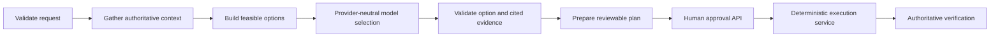

# FastAPI and adapter contracts

The application factory is `continuous_inventory.api.create_app(runtime, provider, local_event_api=False)`. The host injects the runtime and provider-neutral proposal provider. `Runtime.local(directory)` creates separate SQLite files for orchestration state and the simulated domain. `Runtime.simulated()` is ephemeral.

Authentication and authorization integration are intentionally absent. `X-Tenant-Id` and `X-Actor-Id` provide unverified development context and default to `demo` and `local-operator`. Do not expose this build as an enterprise security boundary.

## Run locally

```sh
python -m pip install -e '.[test]'
continuous-inventory serve-demo --port 8765 --workspace output/runtime/local
```

The server listens on `127.0.0.1` unless `--host` is supplied. The local command enables `/local/v1/events`, seeds simulated records on a new workspace, and uses the deterministic fixture provider unless both `CI_MODEL_GATEWAY_URL` and `CI_MODEL_GATEWAY_TOKEN` configure a trusted HTTPS JSON gateway.

For Podman:

```sh
podman compose up --build
```

## Inventory Agent MCP

The stdio MCP entry point is `continuous-inventory-mcp`. For a local, persistent simulation:

```sh
continuous-inventory seed-routing-demo --workspace output/runtime/routing-mcp
CONTINUOUS_INVENTORY_WORKSPACE=output/runtime/routing-mcp continuous-inventory-mcp
```

Optional development identity variables are `CONTINUOUS_INVENTORY_TENANT` and `CONTINUOUS_INVENTORY_ACTOR`. They are trusted local context, not authentication.

| MCP tool | Behavior |
|---|---|
| `inventory.get_routing_capabilities` | Reports the exact MVP boundary and quantity semantics. |
| `inventory.explain_order_fulfillment_state` | Shows whether the order is `OPEN` and lists location address, `QoH`, and `Available`. |
| `inventory.prepare_fulfillment_route` | Creates a non-mutating, versioned route proposal. Stable `request_id` makes preparation idempotent. |
| `inventory.get_route_plan` | Reads the selected route, alternatives, evidence, approval, and execution result. |
| `inventory.approve_route_plan` | Approves only the reviewed current route version. |
| `inventory.execute_route_plan` | Revalidates and idempotently invokes the injected fulfillment domain adapter. |

The deterministic MVP minimizes fulfillment-location count first, then configured location handling cost, location priority, and stable location ID. It records the queried origin address but does not yet call carrier-rating or transit services. `Available` is the sole routable quantity; `QoH` is informational. The simulated execution reduces `Available` without reducing `QoH`, creates assignment and fulfillment-order records, and rejects changed order, location, or inventory versions.

## Operational API

| Method/path | Purpose / JSON fields |
|---|---|
| `GET /health` | Process readiness; does not prove downstream IOM/1TS readiness. |
| `POST /v1/sources` | `id`, `label`, optional `max_age_hours`. |
| `POST /v1/demand/imports` | `source`, CSV `content`, `source_version`, `kind`, `item_map`, `location_map`; complete snapshots only. |
| `POST /v1/demand/activate` | `batch_id`; invalid rows block activation. |
| `POST /v1/demand/outlook` | `item`, `location`, `day`, optional `forecast_source`. |
| `POST /v1/sales-events` | `title`; optional dates, item, location, and projected quantity. Missing projections remain explicit blind spots. |
| `POST /v1/rules` | Customer steering with scope `once`, `item`, or `business`, and mode `order_driven` or `stock_based`. |
| `POST /v1/forecasts/configure` | Algorithm, parameters, item override, and optional effective window. |
| `POST /v1/forecasts/run` | Item, as-of day, history, and horizon. |
| `POST /v1/forecasts/compare` | History and candidate configurations; comparison never activates a winner. |
| `POST /v1/plans/landed-cost` | Source freight/shipping bill, inventory-bill allocations, and optional stable `request_id`. |
| `POST /v1/plans/manufacturing` | Candidate source locations, destination, requirement, linked MO, day, and optional stable `request_id`. |
| `GET /v1/plans` | Up to 100 plans for the development tenant context. |
| `GET /v1/plans/{id}` | Current version and status. |
| `POST /v1/plans/{id}/approve` | `expected_version` from the reviewed plan. |
| `POST /v1/plans/{id}/execute` | Execute an approved plan; empty body. |
| `POST /v1/plans/{id}/verify` | Compare the result with authoritative adapter state; empty body. |
| `POST /v1/plans/{id}/cancel` | Cancel before execution begins; empty body. |

FastAPI publishes OpenAPI at `/openapi.json` and interactive local docs at `/docs`.

## LangGraph boundary

Plan preparation follows this graph:



The provider receives only the objective, feasible options, and evidence. Its structured response must choose a known option and cite known evidence. The graph can prepare a plan; it has no posting tool. Approval, execution, idempotency recovery, and verification remain deterministic services.

`JsonGatewayProvider` sends `{task, context}` and accepts `{option_id, reason, evidence_ids}`. The local fixture provider is deterministic and must not be represented as an LLM quality result.

## Local Kafka-style event API

`POST /local/v1/events` exists only when `local_event_api=True`. It accepts:

```json
{
  "event_id": "evt-1001",
  "event_type": "inventory.quantity.changed",
  "schema_version": 1,
  "source": "iom",
  "occurred_at": "2026-09-27T10:00:00Z",
  "aggregate": {"type": "inventory_item_location", "id": "SKU-A@MAIN", "version": 42},
  "payload": {"on_hand": "25"},
  "correlation_id": "order-77",
  "causation_id": "receipt-9",
  "metadata": {}
}
```

The SQLite inbox deduplicates `event_id` by a full-envelope fingerprint. Reusing an ID with different content returns a conflict. Aggregate versions are marked `contiguous`, `stale`, or `gap`; only contiguous events advance the local stream cursor, while stale and gap events are held. `GET /local/v1/events/{event_id}` reads the persisted receipt.

This endpoint tests producer and consumer contracts without Kafka. It does not emulate partitions, consumer groups, retention, replay, schema registry, backpressure, or asynchronous delivery, and it does not mutate IOM/1TS state.

## Persistence and deployment

SQLite is the only implemented durable backend. The Kubernetes example at `deploy/k8s/sqlite-simulation.yaml` deliberately uses one replica and one `ReadWriteOnce` volume. Horizontal scaling requires a shared `StatePort` implementation that preserves atomic conditional updates, idempotency, bounded queries, and transactional trace appends; that backend is not selected yet.

Temporal workflow execution is out of scope for this implementation. Current recovery is request-triggered through stable plan and domain operation IDs.
