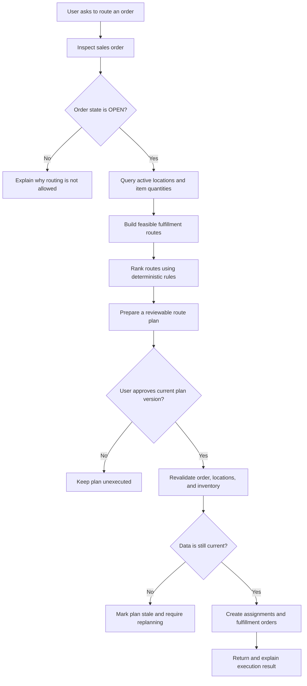

# Fulfillment Routing Overview

## Purpose

Fulfillment routing determines which fulfillment location or combination of locations should fulfill an eligible sales order. The Inventory Agent coordinates the workflow, explains the recommendation, and obtains approval. Deterministic services calculate and execute the route so that the AI cannot invent inventory or directly change operational records.

## High-level flow

## 1. Inspect the sales order

The agent retrieves the sales order and its fulfillment requirements. For the MVP, an order is routing-eligible only when its state is exactly `OPEN`.

The order provides:

- Order lines and requested quantities
- Unit of measure for each item
- Ship-to destination
- Whether split fulfillment is allowed
- Maximum number of permitted fulfillment locations

If the order is not `OPEN`, the agent stops and explains that it is not eligible.

## 2. Gather current fulfillment data

For every order line, the agent queries active fulfillment locations and their item quantities. Location details include the stable location identifier and origin address.

The MVP uses two inventory quantities:

- `QoH`: quantity on hand, shown for information
- `Available`: quantity that may be used for routing

Only `Available` is used to determine whether a location can fulfill an order. The MVP does not use projected or inbound supply.

## 3. Build feasible routes

The routing engine evaluates whether the order can be fulfilled from one location. If that is not possible and the order allows splitting, it evaluates combinations of locations within the order's split limit.

A route is feasible only when:

- Every order line is fulfilled completely
- The required `Available` quantity exists
- Item and unit-of-measure values match
- Every selected location is active
- The order's split rules are satisfied

If no combination satisfies these conditions, the agent returns a clear no-feasible-route result instead of proposing a partial route.

## 4. Rank the feasible routes

Feasible routes are ranked using deterministic rules in this order:

1. Fulfill every order line completely
2. Use the fewest fulfillment locations
3. Minimize configured location handling cost
4. Apply location priority
5. Use stable location ID as the final tie-breaker

The same business inputs therefore produce the same selected route. The AI may explain the outcome, but it does not choose an unsupported allocation.

## 5. Prepare a reviewable plan

The selected route is stored as a versioned proposal. It includes:

- Allocations by order line and fulfillment location
- Origin address for each selected location
- `QoH` and `Available` evidence captured during planning
- Estimated configured handling cost
- Alternative routes, when available
- Order, location, and inventory versions
- Expiration time and explanation codes

Preparing a plan does not reserve inventory, reduce quantities, or create fulfillment orders.

## 6. Obtain explicit approval

The agent presents the route for review and waits for explicit user approval. Approval is tied to the exact plan and version that the user reviewed.

Approval and execution are separate actions:

- Approval authorizes the proposed route.
- Execution performs the operational changes.

The agent must never execute an unapproved route.

## 7. Revalidate before execution

Before executing, the routing service verifies that:

- The sales order is still `OPEN` and unchanged
- Selected locations are still active and unchanged
- Inventory records have not changed
- Sufficient `Available` quantity still exists
- Approval matches the current plan
- The plan has not expired

If any check fails, the plan is marked stale and a new route must be prepared and approved.

## 8. Execute the route safely

After successful revalidation, the fulfillment domain adapter:

- Reduces the allocated `Available` quantity
- Creates an assignment for each selected location
- Creates the corresponding fulfillment orders
- Associates the route result with the sales order
- Records the outcome for safe retries

Execution is idempotent. Retrying the same route returns the original result instead of creating duplicate assignments or fulfillment orders.

## Responsibility boundaries

| Component | Responsibility |
|---|---|
| Inventory Agent | Understand the request, call routing tools, explain the recommendation, and collect approval |
| Routing engine | Validate eligibility, generate feasible routes, rank them, and produce a deterministic plan |
| IOM/1TS adapter | Read authoritative operational data and execute assignments and fulfillment orders |
| User | Review the proposed route and explicitly authorize execution |

## MVP boundary

The implemented MVP supports `OPEN` orders, current `Available` inventory, location addresses, split routing, deterministic selection, approval, revalidation, and idempotent execution.

The current implementation uses a local IOM/1TS simulator. Production use requires real adapters for sales orders, inventory availability, assignments, and fulfillment orders. Carrier rates, transit time, capacity, geocoding, and projected or inbound supply are outside the MVP.

