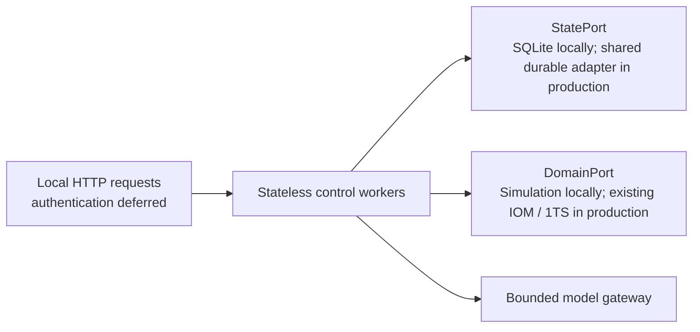

# Implementation status: first runnable slice

This is a local development implementation, not a production inventory system or a completed strategy. No live IOM, 1TS, Shopify, Salesforce, or model integration has been exercised.

## Working now

| Area | Implemented behavior |
|---|---|
| Persistence | Replaceable `StatePort`; tested in-memory and SQLite implementations; tenant-scoped records, conditional versions, atomic trace writes, bounded queries. |
| Service | FastAPI application factory with injected runtime and model provider; OpenAPI schema, strict request models, health endpoint, and explicit local simulation server. Authentication is intentionally absent in this iteration. |
| Demand | CSV validation and staging, complete source-snapshot activation/supersession, duplicate import checks, source freshness, external/internal order reconciliation and partial conversion. |
| Demand assumptions | One selected total-day forecast consumed by confirmed demand; tentative pipeline shown separately. Annual-sales event capture asks for missing inputs and does not invent an uplift. |
| Customer rules | One-time, item, and business scope; validity windows; explicit revocation; conflicting rules require resolution. |
| Forecasts | Customer-selected naive, moving average, seasonal naive, and single exponential smoothing. Business default, item override, and explicit seasonal window. Saved forecast runs and selection versions. |
| Comparison | Rolling-origin comparison on equal folds, MAE, bias, and WAPE (undefined at zero denominator); no automatic model activation. |
| Landed cost | Native simulated Inventory Cost Allocation draft, version-bound review, idempotent posting, source-amount protection, costing and bill-link verification. |
| Manufacturing | Single-component shortage recovery through a simulated transfer, protected donor stock, actual partial/full receipts, readiness verification. |
| Fulfillment routing | MCP v2 tools for `OPEN` sales orders; deterministic single- and multi-location routing from current L1 `Available`, with `QoH` context, location origin address, fewest-location ranking, configured handling-cost tie-break, version-bound approval, idempotent simulated assignment/fulfillment creation, and stale-plan rejection. |
| MCP transport | Official Python MCP SDK v2 over stdio; six structured-output `inventory.*` tools and an in-process protocol integration test. Local trusted actor only; production identity is not connected. |
| Agent boundary | LangGraph trajectory for validation, context collection, feasible-option construction, provider selection, grounded-output validation, and plan preparation. Unknown actions and fabricated evidence are rejected. Approval and execution are outside the graph. Default provider is explicitly deterministic, not an LLM. |
| Event development contract | Local-only HTTP ingestion of Kafka-style versioned envelopes, durable SQLite inbox records, duplicate fingerprint checks, and contiguous/stale/gap classification. It is not a broker or production consumer. |
| Packaging | Python package, Podman-compatible `Containerfile`/Compose definition, and a one-replica Kubernetes SQLite simulation template. |
| Evaluation | Six isolated pilot scenarios, trusted state assertions and trajectory checks, verifier mutation checks, RRSI JSON protocol smoke bridge. |

## Architectural principle: stateless compute, replaceable persistence

Local persistence is allowed. **Business correctness must not depend on a particular worker's process memory.** SQLite is the only implemented durable backend. In-memory state is only for isolated tests. The `StatePort` keeps a future shared store replaceable, but no PostgreSQL adapter or other shared database is selected or implemented now.

Any future backend must satisfy the same atomic conditional-write, query, idempotency, and multi-record consistency contracts. Choosing a database does not relocate inventory or accounting authority from IOM/1TS.

The local SQLite domain database is a **simulator** of authoritative effects. It is not an alternate production inventory ledger. Control and simulated domain state are kept separate so cross-boundary recovery is visible.

## Before multi-host production

- Select, implement, and contract-test a shared state adapter before multiple replicas, including indexed and paginated queries, transaction isolation, connection pooling, migrations, and operational limits. SQLite deployments must remain at one replica.
- Add externally scheduled durable work, retries, event ingestion/outbox integration, worker leases/fencing, tenant quotas, backpressure, cancellation and revocation at the authoritative mutation boundary. No scheduler runs automatically today.
- Confirm the IOM–1TS coordinator, reservation ownership, pending-state handling and failure recovery. The simulator's atomic transaction is not evidence that the real cross-service contract is atomic.
- Integrate real item/BOM/order links, draft/post endpoints, costing completion, physical evidence, and closed-period correction. The local manufacturing requirement is supplied by the caller; it is not yet read from a production MO/BOM.
- Bind authenticated users, policy decisions, resource permissions, and approval revocation to platform identity. Current headers are unverified development context.
- Replace the local HTTP event simulator with Kafka producers/consumers and schema governance in shared environments.
- Add Temporal durable workflows after the command and signal contracts are settled; it is intentionally outside this implementation.
- Move model calls and optimizers to bounded asynchronous workers for high-volume traffic.
- Connect production telemetry and independent outcome collection. Adopt temporal/business holdouts, expert-adjudicated fixtures, model-judge calibration, and staged promotion before enabling autonomy.

## Important functional limits

- No automatic postings to live systems; no automatically delegated actions; no actual book-close implementation.
- Fulfillment routing has no live 1TS, IOM, carrier, rate, transit, warehouse-capacity, or customer-policy integration. The local adapter is a simulator. Cost ranking includes only configured per-location handling cost; address is retained but no geocoding or shipping-rate call is made.
- The MVP uses only current `QoH` and `Available`. It does not route from inbound, projected, lot/serial, or time-phased availability, and it does not explain why `QoH` differs from `Available`.
- Landed-cost target bills and allocation amounts are supplied explicitly. Automatic historical matching/learning, allocation-basis derivation, FX and reversal handling need the owning service contracts and datasets.
- Customer corrections are structured API inputs. Free-text rule compilation and historical behavioral inference are not implemented.
- Demand imports currently support CSV, complete snapshots, quantities in `each`, and explicit source identity. XLSX, revenue-to-unit conversion, arbitrary forecast blends, actual-order cancellation/revision, and connected source feeds remain future work.
- Seasonal events are retained for clarification/scenario review, not automatically expanded into daily demand.
- Forecast histories are equally spaced nonnegative quantities provided by the caller. Gaps and stockout censoring need upstream treatment. No ARIMA, Prophet, XGBoost, intermittent-demand model, intervals, or automatic champion/challenger activation yet. Forecast selection is anchored to the run's as-of date; split planning runs at policy boundaries where needed.
- The RRSI bridge matches the on-call runner/verifier envelope but currently executes deterministic fixtures. It does not yet load candidate harness edits or perform live-model optimization. Zero policy tokens means no LLM was used, not free real inference.
- Local operation recovery can resume after a lost response or process recreation. It is manually/API-triggered and not a production durable workflow engine.

## Forecasting reference points

Customer-selectable methods are consistent with established planning products. Microsoft documents auto-ARIMA, ETS, Prophet and XGBoost in its [Demand forecasting algorithms](https://learn.microsoft.com/en-us/dynamics365/supply-chain/demand-planning/forecast-algorithm-types), while SAP documents moving-average and smoothing strategies in [Forecast Strategies](https://help.sap.com/docs/SAP_NETWEAVER_701/6da591e86c4b1014b43de329b9ffb859/4cbb4caced80606be10000000a42189e.html?locale=en-US). These inform the extensible design; this first slice does not claim feature parity.
